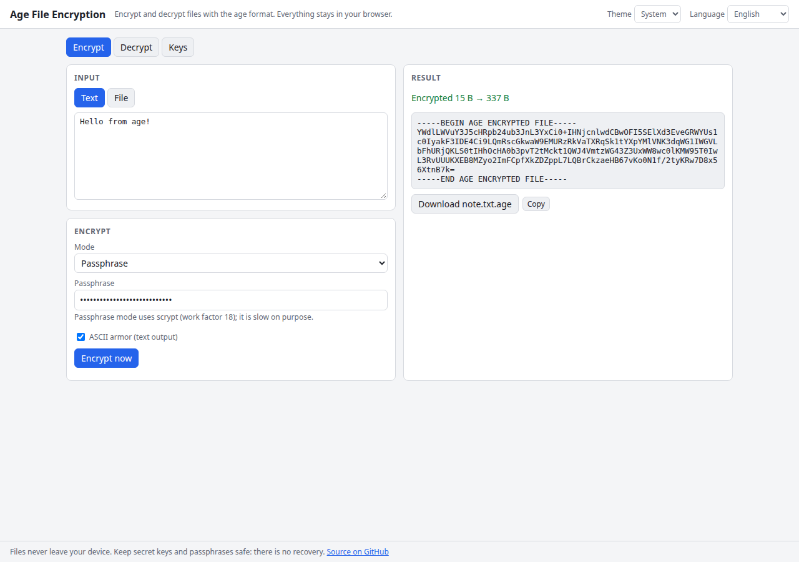

# Age File Encryption

Encrypt files for sharing with the age format: passphrase or X25519 recipients, key generation, ASCII armor. Runs entirely in your browser.

**Try it: [hermes98761234.github.io/age-file-encryption](https://hermes98761234.github.io/age-file-encryption/)**

[](https://github.com/hermes98761234/age-file-encryption/actions/workflows/deploy.yml)



## Features

- **Passphrase or public-key encryption** in the standard [age](https://age-encryption.org) format, interoperable with age/rage.
- **Key generation** (X25519) with copy and key-file download, recipients validation.
- **Files or text**, binary or ASCII-armored output; auto-detects armored input when decrypting.
- **Multiple recipients** at once.
- English and Ukrainian, light/dark/system theme. No backend, no tracking: your data never leaves the browser.

## How it works

Encryption is done by the [age-encryption](https://github.com/FiloSottile/typage) (typage) library, bundled with the site. Passphrase mode uses scrypt (work factor 18); recipient mode uses X25519 with ChaCha20-Poly1305. All work happens locally in the page.

## Quick start

You need [Node.js](https://nodejs.org/) 22.

```bash
git clone https://github.com/hermes98761234/age-file-encryption.git
cd age-file-encryption
npm install
npm run dev       # http://localhost:5173
npm test          # unit tests
npm run build     # static site in dist/
```

## License

MIT
